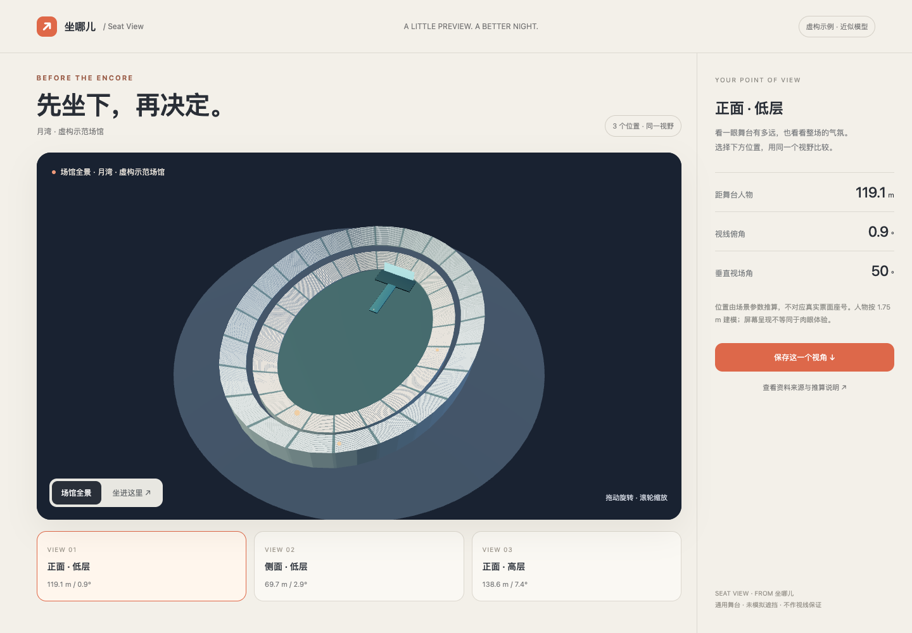
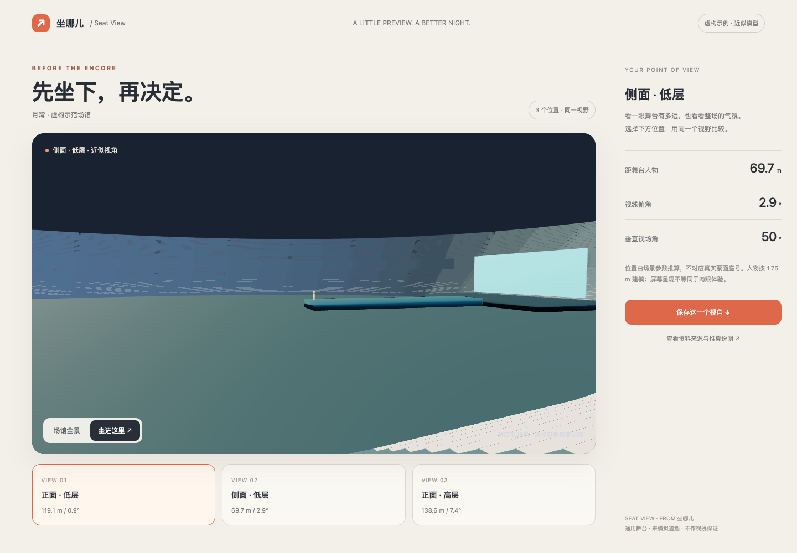

<div align="center">

# 坐哪儿 · Seat View

### 买票前，先坐进去看看。

输入一座场馆，把「这个位置看起来怎么样」变成可以亲自切换的 3D 视角。

[在线试玩](https://sesamehut.github.io/seat-view/) · [快速体验](#一分钟体验) · [安装 Skill](#让你的-ai-学会这一招) · [能力与边界](#它能做什么) · [工作方式](#从一句话到一个视角)




<sub>真实运行画面 · 虚构示例场馆 · 通用延伸台 · 所有视角均为近似模型</sub>

</div>

---

**正面高层能看完整舞台，侧面低层离人更近——但差多少？**

Seat View 是来自「坐哪儿」的开源 Agent Skill。它把场馆资料检索、参数化场景生成和视角比较串成一个小工作流。你提问题，AI 整理依据；生成器负责把同一份参数变成可重复打开的场景。

没有账号，没有付费 API，没有服务端。先用 Python 运行示例；想进一步改模型，再交给 Blender。

> **当前是 v0.1 视角预演工具。** 它生成可修改的椭圆阶梯看台与通用舞台，表达空间关系。它不会凭一个场馆名字就精确复刻建筑，也没有真实票面座号映射。真实场馆的结果需要 AI 检索资料，并对估算部分作出说明。

## 一分钟体验

**[直接打开在线示例 →](https://sesamehut.github.io/seat-view/)** · 不安装，先感受三个位置的差别。



需要 **Python 3.9+** 和支持 WebGL 的现代浏览器。首次下载仓库需要网络，运行虚构示例不需要网络。

```bash
git clone https://github.com/sesamehut/seat-view.git
cd seat-view
python3 skills/seat-view/scripts/build.py --demo --output ./preview
```

打开 `preview/index.html`，就可以：

1. 拖动查看场馆与舞台的位置关系。
2. 点击三个位置卡片，坐进对应视角。
3. 查看距离、俯角和资料说明，保存带说明的 PNG。

Windows 可用 `python` 或 `py` 代替 `python3`。如浏览器限制本地文件，用新的输出目录启动本地预览：

```bash
python3 skills/seat-view/scripts/build.py --demo --output ./preview-local --serve 8765
```

打开 `http://127.0.0.1:8765`；按 `Ctrl-C` 结束。生成器不会覆盖已有产物，迭代时换一个输出目录即可。手机端适合通过本地静态服务或你自己发布的 HTTPS 页面体验；手机文件管理器未必支持直接执行 HTML。

## 让你的 AI 学会这一招

本仓库采用 [Agent Skills 开放格式](https://agentskills.io/specification)，Skill 内容集中在 [`skills/seat-view`](skills/seat-view)。支持读取该格式、执行本地命令的代理可以使用它；真实场馆研究还需要代理具备网页检索能力。

使用 [Skills CLI](https://github.com/vercel-labs/skills) 安装（其当前版本需要 Node.js 22.20+）：

```bash
npx skills add sesamehut/seat-view --skill seat-view
```

也可以下载仓库，将整个 `skills/seat-view` 文件夹复制到你的客户端支持的 Skills 目录，或直接让代理读取其中的 `SKILL.md`。不要只复制这一个 Markdown 文件：生成器、模板和运行库也是 Skill 的一部分。

然后这样说：

```text
用 seat-view 帮我预演上海体育场的演唱会视角。
先查场馆资料，舞台先假设放在短边。
对比侧面低层、正面低层、正面高层，告诉我哪些数据是估算的。
```

想先试试？

```text
用 seat-view 的离线示例，给我一个可以打开的 3D 场馆视角。
```

格式可移植不等于每个客户端都已实测。当前验证范围见 [验证记录](docs/validation.md)；CodeArts 和其他市场的安装、上传仍需在各自环境验证。

## 它能做什么

| 你想做的事 | v0.1 的交付 |
| --- | --- |
| 在不同位置「坐一下」 | 三个近似机位，固定 50° 垂直视场角，公平比较空间关系 |
| 输入真实场馆开始研究 | AI 整理运营方、建筑师和工程资料，逐项注明已核实 / 估算 / 未知 |
| 试试不同舞台 | 通过场景 JSON 生成端台、延伸台、中心台 |
| 保存或分享结果 | 自包含 HTML、带说明的 PNG、可复现的 JSON 和资料摘要 |
| 继续建模 | 可选导出 `.blend` 和 `.glb`，保留三台相机 |

没有售票接口、票价推荐、遮挡保证、声学模拟，也没有演唱会实时舞美数据库。屋顶、立面、栏杆、人群和控台塔不在默认模型内。**“模型中没有挡住”不代表真实现场没有遮挡。**

## 从一句话到一个视角

```text
你想看的场馆 / 舞台 / 位置
             ↓
      AI 查资料，记录依据
             ↓
  venue.json · 尺寸 + 视角 + 假设
             ↓
      确定性的参数化生成器
        ↙               ↘
 可交互 HTML          可选 Blender
  换位置、保存图        编辑、导出 GLB
```

**把判断交给 Skill，把几何交给代码。** 默认体验不要求安装 Blender；两个出口共享同一份网格和相机数据，避免浏览器与 Blender 各自生成一套场馆。

生成结果包含四个文件：

```text
preview/
├── index.html    # 内嵌 Three.js 与场景，桌面可直接打开
├── venue.json    # 输入参数、资料链接和推算说明
├── scene.json    # 网格、相机与几何测量
└── brief.md      # 便于阅读的资料摘要
```

场景中不加载第三方远程资源。来源链接仅在你主动点击时打开；没有分析埋点或数据上传。

## 想改成你的场馆？

复制 [`demo-venue.json`](skills/seat-view/assets/demo-venue.json)，请 AI 按 [研究指南](skills/seat-view/references/research.md) 填写资料，再按 [参数说明](skills/seat-view/references/spec.md) 修改尺寸与位置：

```bash
python3 skills/seat-view/scripts/build.py --spec ./my-venue.json --output ./my-preview
```

`kind: researched` 表示参考过来源的简化场景，**不表示数字孪生或测绘级精度**。同一场馆不同演出的舞台布局需要分别核验。生成排号和角度是模型坐标，不是真实票务分区。

## Blender 是下一步，不是第一步

已安装 Blender 后运行：

```bash
blender --background --factory-startup \
  --python skills/seat-view/scripts/blender_export.py -- \
  --scene preview/scene.json --output preview/blender
```

得到 `venue.blend` 和 `venue.glb`。使用全新后台进程，不会改动你正在编辑的 Blender 文件。支持范围和坐标换算见 [Blender 交付](skills/seat-view/references/blender.md)。

## 为什么只做这么多？

我们调研了六个公开 Skill：入口从 39 到 314 行；也有仅 116 行入口、实际附带 148 个文件的项目。**入口短，并不代表使用起来轻。** 首版选择把成本放在可复现的生成器上，把依赖控制在 Python 与浏览器，让第一次体验足够短。

完整取舍和来源见 [设计记录](docs/design.md)。下一步更值得做的是用真实场馆资料改善看台轮廓、加入有依据的分区映射，并积累用户反馈；继续增加炫目的功能并不能替代这些基础。

## 一起把视角做准

欢迎提交一个具体问题，而不只是“场馆不像”：

- 场馆名称、城市，以及可公开引用的资料链接。
- 哪一块结构或哪个视角不对；预期和实际有什么不同。
- 去除个人信息的输入 JSON，以及系统、Python、浏览器版本。

贡献方式见 [CONTRIBUTING.md](CONTRIBUTING.md)。只接收你有权贡献的内容；官方图纸可记录链接，未经许可不把原图、票面个人信息或付费模型放进仓库。

## License & credits

新写的 Skill、生成器、模板与原创示例采用 [MIT](LICENSE)。随包的 Three.js 保留其 [MIT 许可](skills/seat-view/assets/vendor/LICENSE.three)。Blender 是可选的外部软件。第三方资料链接与其中的图片、图纸不因此获得本仓库的许可。

本项目来自「坐哪儿」对观演视角的探索，独立运行，不依赖产品服务，也不包含产品购买的场馆模型。`坐哪儿` 名称用于标明项目来源；MIT 许可不构成品牌背书。

---

<div align="center">

**先有一个真实的问题，再做一个别人也用得上的 Skill。**

Built for the moment before you choose your seat.

</div>
